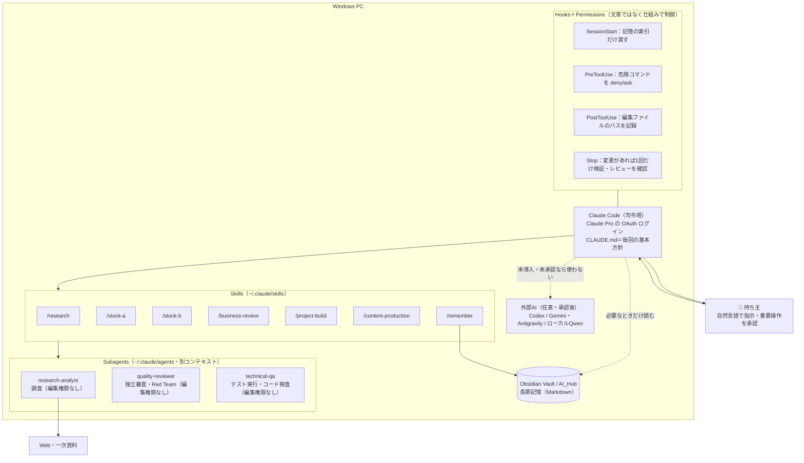
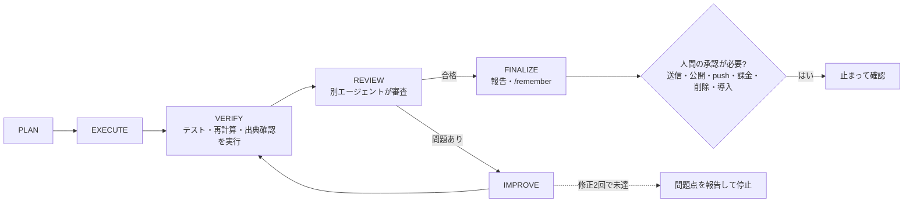

# SYSTEM_ARCHITECTURE

基本原則：**指示 → タスク分解 → 専門エージェント → 外部ツール → 品質検査 → 修正 → 成果物 → 記憶保存**

## 1. 全体構成

## 2. 作業ループ

## 3. 役割分担

| 役割 | 担当 | 理由 |
|---|---|---|
| 司令塔・高度な推論・企画・統合 | Claude Code（メイン） | Claude Pro の契約内で使える |
| 調査 | research-analyst | 調査の大量のページ読み込みでメインの文脈を汚さない |
| 独立審査・反対意見 | quality-reviewer | 作業者と別の文脈で審査。自分の成果物の自己確認では不十分なため |
| コード検査・テスト | technical-qa | 実装担当と検査担当を分ける。編集権限を持たせない |
| 別モデルのレビュー | Codex / Gemini（任意） | 導入済み・追加費用なし・承認済みの場合のみ |
| 軽量処理 | ローカル Qwen（任意） | 分類・整形のみ。VRAM 6GB の制約 |
| 最終判断 | 人間 | 送信・公開・お金・削除・導入 |

同時稼働は原則2体まで（CLAUDE.md の規則）。サブエージェントからの更なる委任は `CLAUDE_CODE_MAX_SUBAGENT_SPAWN_DEPTH=1` で止める。

## 4. 記憶の設計

| 層 | 置き場所 | 読み込み方 |
|---|---|---|
| 毎回の基本方針 | `~/.claude/CLAUDE.md`（200行未満） | 毎回自動 |
| 作業手順 | `~/.claude/skills/*/SKILL.md` | 呼び出したときだけ |
| 索引 | `AI_Hub/00_Home/PROJECT_INDEX.md`・`MEMORY_INDEX.md` | 起動時に先頭だけ（SessionStart フック、3,000字まで） |
| 長期記憶の本体 | `AI_Hub/01_Projects`・`02_Knowledge`・`03_Research`・`DECISIONS.md`・`USER_PROFILE.md` | 必要なノートだけ検索して読む |
| Claude Code 自身の自動メモ | `~/.claude/projects/<project>/memory/`（公式の auto memory） | Claude Code が自動で管理。持ち主向けの知識は AI_Hub に置く（二重管理を避けるため） |

## 5. 安全の仕組み（文章だけに頼らない）

| 守ること | 仕組み |
|---|---|
| 権限確認を飛ばさない | `permissions.defaultMode: default`、`disableBypassPermissionsMode: disable` |
| 秘密情報を読まない | `permissions.deny`: `.env`・`.credentials.json`・`~/.ssh`・`*.pem`、ガードの read-secrets |
| 危険なコマンド | ガード（deny）：全体削除・ディスク初期化・強制push・権限スキップ・ダウンロード即実行・APIキー設定 |
| 確認が必要なコマンド | permissions の ask ＋ ガード（ask）：push・デプロイ・削除・インストール・システム設定・メール送信 |
| 完了前の検証 | Stop フック（変更があれば1回だけ確認を求める。stop_hook_active でループ防止） |
| API課金の防止 | `ANTHROPIC_API_KEY` を設定しない（ガードが設定コマンドを拒否、PHASE 0 で有無を確認） |

ガード自体が故障した場合は作業を止めず通常の権限判定に任せる（permissions の deny/ask は独立して効く）。

## 6. 拡張の方法
- 専門エージェント：`~/.claude/agents/` に1ファイル追加
- スキル：`~/.claude/skills/<名前>/SKILL.md` を追加（繰り返し発生する作業だけ）
- MCP：`claude mcp add ...`。導入前に提供元・権限・送信先・費用を確認（WORKFLOWS.md の手順）
- スマートフォン操作：Claude Code の Remote Control（Pro で利用可。PC で `claude` が動いている必要あり）
- 定期実行：基本環境が安定してから検討
