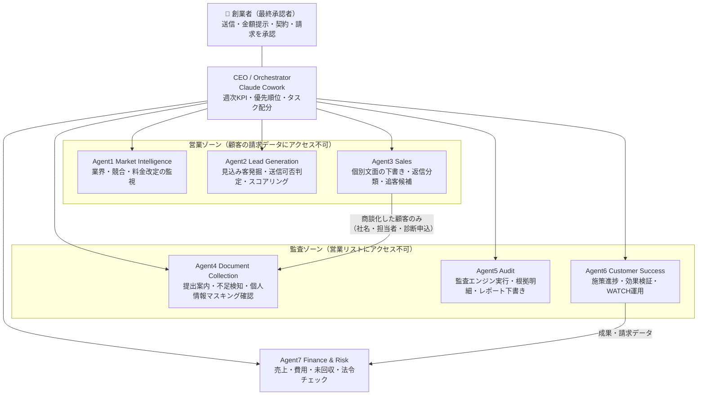
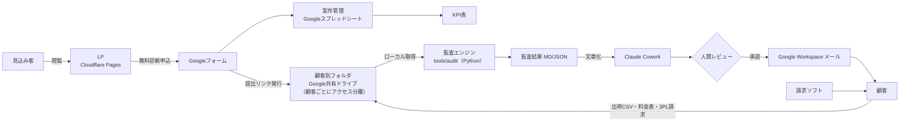
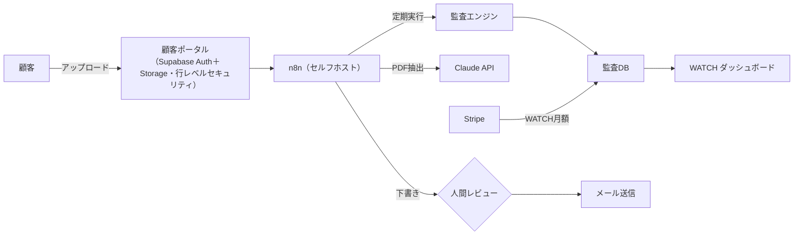

# TASK 5：AIエージェント組織図・システム構成図

## 1. 設計原則

1. **数値は決定論的プログラムが出す。** LLM は抽出・分類・文章化のみ。顧客に出す金額は必ず `tools/audit` の出力から転記
2. **営業データと顧客データを分離。** 営業エージェントは顧客の請求書にアクセスできない。監査エージェントは営業リストにアクセスできない
3. **取り消しにくい操作は人間承認。** 外部メール送信、顧客への金額提示、契約、請求書発行、ベンダーへの連絡は、すべて人間が最終承認
4. **最初は「エージェント＝役割定義＋プロンプト＋手順書」。** 常時稼働の自律エージェントは作らない。再現性が確認できた工程から n8n で定期実行化する
5. **初期段階では、顧客の実データを Claude Cowork・Claude Code・外部AIに入力しない。** 監査は手元の決定論的プログラムで行い、AIには調査・分類・草案・匿名化済みヒアリング記録の分析のみを任せる（`docs/legal/03_顧客データ取扱規程_初版.md`）
6. 人間の承認が必須：顧客への送信、監査結果の確定、成功報酬の請求、契約変更・交渉（当社は行わない）、データ削除・権限変更

## 2. 組織図

## 3. エージェント定義

| Agent | 実体（Phase 1-2） | 入力 | 出力 | 人間承認ポイント | 自動化の時期 |
|---|---|---|---|---|---|
| CEO | Cowork（週次） | KPI表、各Agentの出力 | 週次レポート、翌週タスク | 優先順位変更 | Phase 3 で n8n から週次起動 |
| 1 Market Intelligence | Cowork | 調査テーマ | 調査メモ（出典・確認日付き） | なし（社内資料） | Phase 3：運賃改定ニュースの週次監視 |
| 2 Lead Generation | Cowork＋スクリプト | 対象条件 | 見込み客リスト（送信可否・取得元・スコア） | リストの送信可否判定の抜き取り確認 | Phase 3 |
| 3 Sales | Cowork | 見込み客リスト、テンプレート | 個別文面の下書き、返信分類 | **全送信を人間承認** | 送信自体は自動化しない |
| 4 Document Collection | Cowork＋フォーム | 診断申込 | 提出案内、不足リスト | 個人情報が含まれていた場合の対応 | Phase 4 |
| 5 Audit | `tools/audit`（手元で実行。顧客データはAIに渡さない） | 出荷CSV、料金表、3PL請求 | 監査結果JSON、レポート下書き | **顧客への金額提示前に必ず人間レビュー** | Phase 4 |
| 6 Customer Success | Cowork | 施策リスト、月次データ | 進捗表、効果検証、WATCHレポート | 効果検証の数値確定 | Phase 5 |
| 7 Finance & Risk | スプレッドシート＋Cowork | 案件表、入金 | 月次PL、未回収リスト、法令チェック結果 | 請求書発行 | Phase 5 |

## 4. システム構成図（Phase 2 時点：最小構成）

## 5. Phase 4 以降の構成（顧客10社超）

## 6. データの流れと保管

| データ | 保管場所 | アクセス可能 | 保管期間 |
|---|---|---|---|
| 見込み客リスト（社名・公表連絡先・取得元・送信可否） | 営業用スプレッドシート | 創業者、Agent2/3 | 配信停止者は永久に除外リストで保持 |
| 送信記録・同意記録 | 営業用スプレッドシート | 創業者、Agent7 | 特定電子メール法上の保存期間を弁護士に確認 |
| 顧客の出荷CSV・料金表・請求書 | 顧客別共有ドライブ | 創業者、Agent4/5/6 | 契約終了後90日で削除 |
| 監査結果 | 顧客別共有ドライブ | 同上 | 同上（効果検証の根拠は請求関連書類として保管） |
| 請求書・入金 | 請求ソフト | 創業者、Agent7 | 法定保存期間 |

## 7. 承認フロー

| 操作 | 起案 | 承認 | 記録 |
|---|---|---|---|
| 営業メール送信 | Agent3 | 創業者（1通ずつ、または送信可否確認済みリストのバッチ承認） | 送信ログ |
| 顧客への診断結果・金額提示 | Agent5 | 創業者（根拠明細を確認） | レポート版数 |
| 見積依頼の送付（顧客名義） | Agent6 | 顧客＋創業者 | 委任記録 |
| 効果検証の確定 | Agent6 | 顧客の書面承認 | 承認メール |
| 請求書発行 | Agent7 | 創業者 | 請求ソフト |
| 契約・解約・支払い | — | 顧客本人のみ（当社は代行しない） | — |
