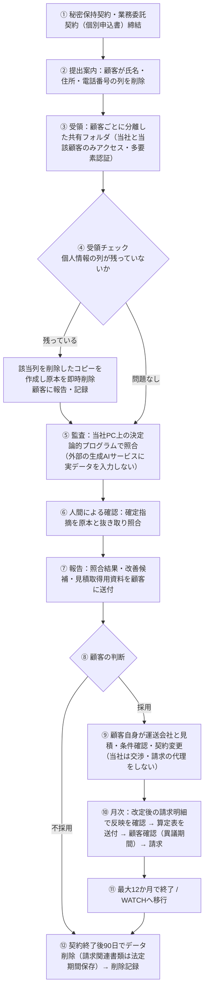

# 業務フロー：顧客データの受領から削除まで（弁護士レビュー用）

**このフローは弁護士レビューとデータ取扱規程の確定後に運用を開始する。** それまで顧客の実データは受領しない。

## 1. 全体フロー

## 2. 相手方（運送会社・3PL）との関係

| 場面 | 当社 | 顧客 |
|---|---|---|
| 請求差異の照会 | 照会用の明細（追跡番号・請求額・契約単価・差額）を作成 | 自ら照会・判断 |
| 見積の取得 | 見積依頼に必要な出荷プロファイル資料を作成。顧客名義の送付事務の可否は弁護士確認中 | 送付・やり取り・採否判断 |
| 条件交渉・契約変更 | 行わない | 行う |
| 返金・相殺の請求 | 行わない | 行う |
| 相手方が拒否・紛争化 | 関与を終了し、弁護士への相談を勧める（有償紹介はしない） | 判断 |

## 3. 記録

| 記録 | 保存先 | 保存期間 |
|---|---|---|
| 受領ファイル名・日時・個人情報の有無・処置 | 受領台帳 | 契約終了後1年（案） |
| 監査実行ログ（入力ファイル、プログラムのバージョン、出力） | 顧客別フォルダ | 契約終了後90日 |
| 算定表・顧客の確認記録 | 顧客別フォルダ | 請求関連書類として法定期間 |
| 削除記録（日時・対象・実施者） | 削除台帳 | 永年（案） |
